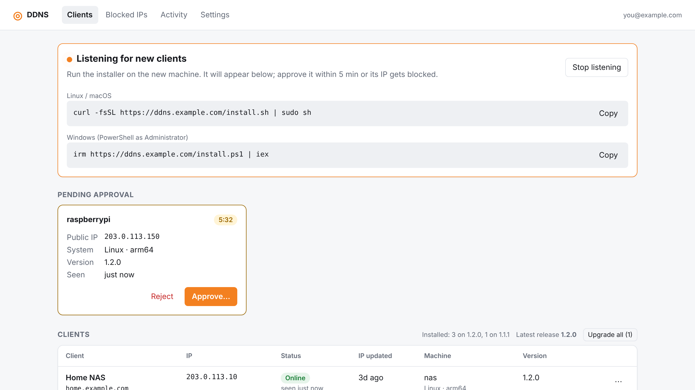
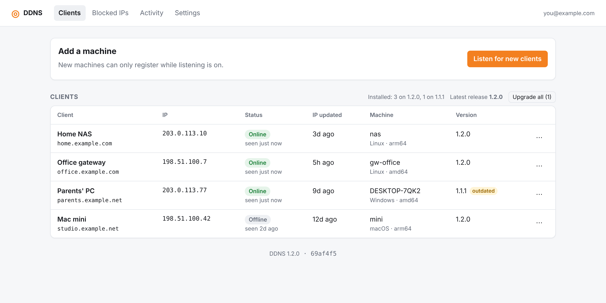
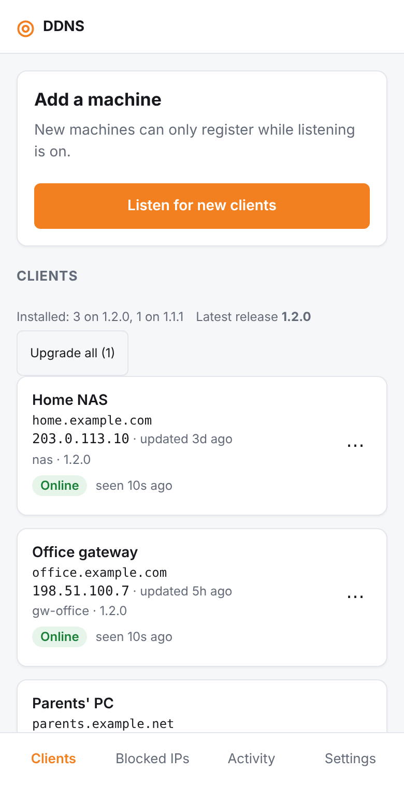
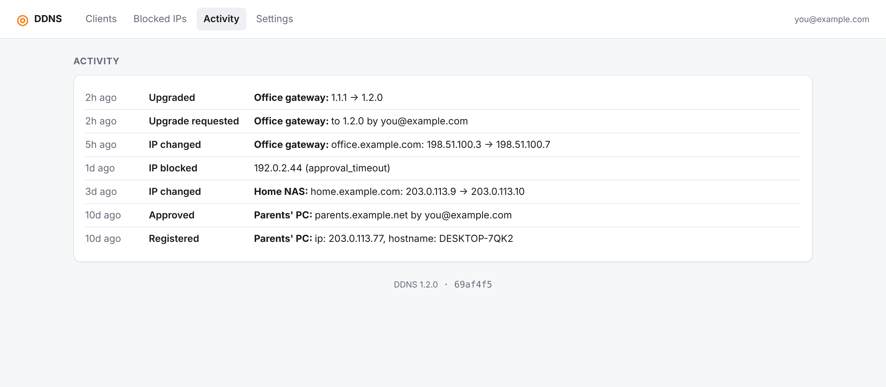

# User guide

This guide covers day-to-day use of cloudflare-ddns: adding machines, choosing
their DNS records, and keeping them up to date.

## Concepts

- **Client:** a machine running `ddns-client`. Each client owns exactly one
  DNS **A record** (IPv4), for example `home.example.com`.
- **Pending client:** a machine that has registered but that you haven't
  approved yet. It can't change any DNS.
- **Online / offline:** a client is online if its last heartbeat (sent every
  60 seconds) arrived within the last ~3 minutes.
- **Blocked IP:** a public IP that isn't allowed to register new clients,
  usually because a pending client from it wasn't approved in time.

## Signing in

Open **https://ddns.example.com**. Cloudflare Access asks you to sign
in (with the method configured for the app, such as a one-time code by email).
Only people allowed by the Access policy can open the dashboard.

## Installing the dashboard as an app

The dashboard can be added to your phone's home screen and opens full screen,
like a native app:

- **Android (Chrome):** open the dashboard, sign in, then tap **⋮ → Install
  app** (or **Add to Home screen**).
- **iPhone / iPad (Safari):** open the dashboard, sign in, then tap **Share →
  Add to Home Screen**.

Desktop Chrome and Edge offer the same through the install icon in the address
bar. The app only keeps the page itself for a fast start; client status, IPs
and timestamps are always loaded live. When your Access sign-in has expired,
the app sends you back through the Access login (or shows **Sign in again**).

## Adding a machine

1. In the dashboard, click **Listen for new clients**. While it's off, new
   machines can't register at all. The install commands appear in the same
   box, ready to copy.
2. On the machine, run the one-liner for its OS. No questions are asked.

   **Linux / macOS** (as root or with sudo):

   ```bash
   curl -fsSL https://ddns.example.com/install.sh | sudo sh
   ```

   **Windows** (PowerShell, *Run as Administrator*):

   ```powershell
   irm https://ddns.example.com/install.ps1 | iex
   ```

   The client is installed as a service (systemd on Linux, launchd on macOS,
   a Windows service on Windows) and starts immediately. Running the
   one-liner again repairs the install and updates it to the latest release.

   


3. Within a few seconds the machine appears under **Pending approval** with
   its public IP, hostname and OS, plus a countdown to the approval timeout.
4. Click **Approve…**. Optionally give the machine a **name** (for example
   "Home NAS"; it starts as the machine's hostname), then pick the **zone**
   (domain) and type the **record name** (for example `home` for
   `home.example.com`, or `@` for the zone itself). Click **Approve**. If you don't recognise the machine, click **Reject**:
   it's refused and its IP is blocked.
5. Click **Stop listening** when you're done.

From now on the record follows the machine's public IP. If the record doesn't
exist yet, it's created on the first heartbeat after approval.

### If you don't approve in time

A pending client must be approved within the **approval timeout** (5 minutes by
default; change it in **Settings**). Otherwise it's rejected and its public IP
is added to **Blocked IPs**. The client keeps retrying quietly in the
background.

Note that blocking is per public IP: other machines behind the same router are
blocked from registering too.

## The clients list

For each client you see its name and record, the current IP, online or
offline, when the client was last seen, when the IP last changed, the machine
(hostname and OS) and the installed client version. A client without a name
is shown by its hostname. Versions behind the latest release are marked
**outdated**. A ⚠ line under the record shows the last error, such as a
failed DNS update or upgrade. The page refreshes every few seconds.



On a phone, the navigation moves to a tab bar at the bottom of the screen and
each client becomes a card: name and record, current IP and when it last
changed, hostname and version, then its status. Tap **⋯** on a card for its
actions. Blocked IPs are shown as cards the same way.



Above the table, **Installed** sums up which client versions are running
(for example "3 on 1.0.0, 1 on 0.9.0").

## Changing or removing a client

Use the **⋯** menu on a client's row:

- **Edit name and record…:** rename an approved client, or move it to another
  zone or record name. A new record is written on its next heartbeat; the old
  one is left as is. Clear the name to show the hostname again.
- **Rename…:** set the name of a revoked client.
- **Revoke:** the client can no longer update DNS. The record is left as is.
- **Delete:** removes the client, optionally deleting its DNS record too.

To remove the software from a machine, run the installer with `uninstall`
(this also deletes the machine's identity, so a reinstall registers as a new
client):

```bash
curl -fsSL https://ddns.example.com/install.sh | sudo sh -s -- uninstall
```

```powershell
& ([scriptblock]::Create((irm https://ddns.example.com/install.ps1))) uninstall
```

## Blocked IPs

**Blocked IPs** lists every blocked address, why it was blocked and when.
Click **Unblock** to allow it again. A client behind that IP reappears under
**Pending clients** on its next retry (within a few minutes), as long as
**Listen for new clients** is on.

## Activity

**Activity** lists recent events, each with the client it's about:
registrations, approvals, renames, rejections, blocks and unblocks, IP changes,
DNS errors, upgrades and settings changes.



## App version

Versions are shown without the "v" prefix (`1.1.0`); release tags keep it
(`v1.1.0`).

The footer of every page shows the dashboard version and commit (for example
`DDNS 1.1.0 · abc1234`). If a newer version was deployed while the page was
open, the footer says so; click **Reload** to load it. `/health` reports the
same version.

## Upgrading clients

Above the clients table the dashboard shows the latest released client
version. **Upgrade all** moves every client to it; **Upgrade to …** in a row's
**⋯** menu upgrades only that machine (handy for trying a release on one
machine first). Clients pick it up on their next heartbeat, verify the
download, replace themselves and restart. Until a client reports the new
version, its row shows an **Upgrading to X.Y.Z** badge under its status, at
every screen width. If an upgrade fails, the error is shown on the
client's row and the client keeps running the old version.

## Settings

| Setting | Default | Meaning |
| --- | --- | --- |
| Approval timeout | 5 minutes | How long a pending client waits for approval before it's rejected and its IP blocked |

## Troubleshooting

- **The machine never shows up as pending.** Check that *Listen for new
  clients* is on and that its IP isn't under *Blocked IPs*. On the machine,
  check the service logs: `journalctl -u ddns-client -f` (Linux),
  `tail -f /var/log/ddns-client.log` (macOS), or Event Viewer → Windows
  Logs → Application (Windows).
- **A client shows offline.** The machine is off, has no internet, or the
  service stopped. Restart the service and it reconnects on its own.
- **The record has the wrong IP.** The Worker uses the IP the heartbeat comes
  from. If the machine sends traffic through a VPN or proxy, that address is
  what gets published.
